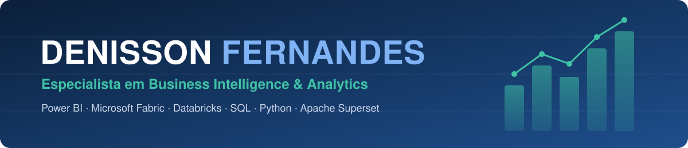

  
  

---

### 👨‍💻 Sobre mim

Profissional de dados com **7 anos de experiência**, atuando de ponta a ponta: da **ingestão e modelagem em Databricks e SQL** aos **painéis que a diretoria usa para decidir**.

Hoje administro o ambiente **Power BI Premium / Microsoft Fabric de uma das maiores varejistas do Brasil**, onde estruturei o **Centro de Excelência (CoE) de BI** e defini padrões de governança e boas práticas adotados pelas áreas de negócio. Escolho a ferramenta pelo problema — Power BI, Apache Superset ou Metabase — com pipelines em Databricks, SQL e Python.

<table>
  <tr>
    <td align="center" width="25%"><h3>7 anos</h3>trabalhando com dados</td>
    <td align="center" width="25%"><h3>Fabric</h3>administração do ambiente Premium</td>
    <td align="center" width="25%"><h3>CoE</h3>de BI estruturado em grande varejista</td>
    <td align="center" width="25%"><h3>10+</h3>grandes marcas atendidas em consultoria</td>
  </tr>
</table>

### 🧭 Áreas de atuação

- 📊 **Business Intelligence** — Power BI (DAX, Power Query M), Apache Superset, Metabase, dashboards executivos
- 🏛️ **Plataforma & Governança** — Power BI Premium, Microsoft Fabric, Centro de Excelência, padrões e boas práticas
- ⚙️ **Engenharia de Dados** — pipelines ETL/ELT, arquitetura medalhão (Bronze/Silver/Gold), Delta Lake
- 🏗️ **Modelagem de Dados** — Star Schema, Data Warehouse, Data Marts
- 🔌 **Integrações** — APIs REST (Power BI, ERPs como Sankhya e TOTVS), OAuth2
- 🔄 **DataOps / CI-CD** — deploy automatizado de artefatos de BI com GitHub Actions e fabric-cli
- 🧠 **IA aplicada a dados** — agentes de IA, MCP (Model Context Protocol), automação com LLMs

### 🛠️ Stack

**BI & Visualização** 

**Engenharia de Dados & Cloud** 

**Bancos de Dados** 

**Automação, DevOps & IA** 

### 🎓 Formação

- **Pós-graduação em Engenharia de Dados & IA** — Unifatec *(em andamento)*
- **MBA em Business Intelligence & Analytics 360** — Unifatec *(concluído, 2026)*
- **Bacharelado em Sistemas de Informação** — Centro Universitário Uninorte *(2020)*

### 🎯 Foco atual

`Lakehouse com Databricks e Fabric` · `Governança e DataOps` · `CI/CD para Power BI` · `Agentes de IA aplicados a pipelines de dados`

---

> *"Dados contam histórias. Meu trabalho é garantir que elas sejam confiáveis, compreensíveis e úteis para a tomada de decisão."*

